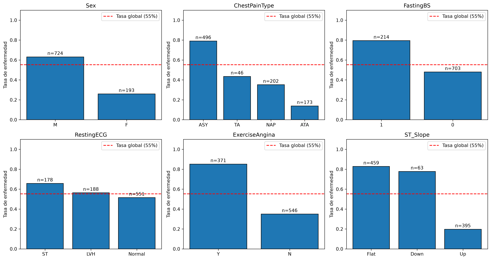

# Predicción de enfermedad cardíaca

Proyecto de práctica de aprendizaje supervisado con scikit-learn: predecir si un paciente tiene enfermedad cardíaca (`HeartDisease`) a partir de datos clínicos y de una prueba de esfuerzo.

Como es un problema clínico, un **falso negativo** (un enfermo clasificado como sano) es el error más grave. Por eso la métrica principal es el **recall** de la clase enfermo, acompañado del ROC-AUC.

## Dataset

[Heart Failure Prediction](https://www.kaggle.com/datasets/fedesoriano/heart-failure-prediction) (fedesoriano, Kaggle, licencia ODbL-1.0). Tiene 918 pacientes y 11 variables. Combina 5 bases del [UCI Heart Disease](https://archive.ics.uci.edu/dataset/45/heart+disease): Cleveland, Hungría, Suiza, Long Beach VA y Statlog.

Las clases están razonablemente balanceadas: 55 % de los pacientes tiene enfermedad y 45 % no.

## Resultados

### Calidad de datos

- **`Cholesterol = 0` en 172 pacientes (19 %).** Es un valor imposible, así que se trató como faltante. No es un faltante aleatorio: el 88 % de esos pacientes tiene enfermedad, contra el 48 % del resto. Por eso se imputó con la mediana y se agregó una columna indicadora de faltante, en vez de eliminar las filas.
- **`RestingBP = 0` en 1 paciente.** Se eliminó esa fila.
- **`Oldpeak` negativo en 13 pacientes.** Se mantuvieron, porque el segmento ST puede tanto deprimirse como elevarse.

### Comparación de modelos

Validación cruzada estratificada de 5 folds sobre train (733 pacientes):

| Modelo | Recall | ROC-AUC |
|---|---|---|
| Dummy (clase mayoritaria) | 1,00 | 0,50 |
| **Regresión logística** | **0,90** | **0,92** |
| Random Forest | 0,90 | 0,93 |
| Gradient Boosting | 0,87 | 0,93 |
| KNN | 0,87 | 0,90 |
| Árbol de decisión | 0,83 | 0,80 |

La regresión logística, Random Forest y Gradient Boosting quedaron empatados: sus diferencias son menores que la desviación estándar entre folds (±0,02 a 0,04). Se eligió la **regresión logística** por ser el modelo más simple e interpretable. El ajuste de hiperparámetros con `GridSearchCV` eligió `C=0.1`, aunque casi no mejoró el ROC-AUC (de 0,924 a 0,925).

### Evaluación final en test (184 pacientes)

El umbral de decisión se ajustó con validación cruzada **sobre train**, con el criterio de alcanzar un recall ≥ 0,95 con la mayor precisión posible. El resultado fue un umbral de **0,275**, que luego se aplicó una sola vez al test:

| Umbral | Recall (enfermos) | Precisión | Especificidad (sanos) | Enfermos no detectados | Sanos mal clasificados |
|---|---|---|---|---|---|
| 0,5 (por defecto) | 0,90 | 0,89 | 0,87 | 10 de 102 | 11 de 82 |
| **0,275 (elegido)** | **0,96** | **0,81** | **0,72** | **4 de 102** | **23 de 82** |

- El **ROC-AUC en test es 0,94**, en línea con la validación cruzada (0,93 ± 0,02). El modelo generaliza bien.
- Bajar el umbral reduce los enfermos no detectados de 10 a 4, a cambio de duplicar los falsos positivos. Este compromiso es razonable para un uso de **screening** (decidir a quién hacerle más exámenes), no para un diagnóstico definitivo.

### Variables más relevantes



Según los coeficientes de la regresión logística (odds ratios):

- **Pendiente del ST (`ST_Slope`):** una pendiente plana se asocia a odds de enfermedad **~6 veces mayores** que una ascendente. También es la variable de la que más depende el modelo según la *permutation importance*.
- **Dolor torácico asintomático (`ChestPainType = ASY`):** odds ~3,6 veces mayores que con angina atípica (ATA).
- **Sexo masculino:** odds ~2,1 veces mayores.
- **Angina inducida por ejercicio:** odds ~2,0 veces mayores.
- **`Oldpeak`:** cada desviación estándar adicional se asocia a odds ~1,5 veces mayores.
- **Frecuencia cardíaca máxima (`MaxHR`):** una frecuencia más alta se asocia a **menor** riesgo, con odds ~18 % menores por cada desviación estándar.
- **Colesterol:** su valor casi no influye, pero **su ausencia sí** (odds ~1,9 veces mayores). Además, `Cholesterol` es la segunda variable más importante en la *permutation importance*, y esa importancia viene principalmente del indicador de faltante.

Estas son asociaciones, no relaciones causales.

## Limitaciones

- **Dataset pequeño:** 917 pacientes. Las métricas y las importancias en test, calculadas sobre 184 pacientes, son ruidosas.
- **Datos heterogéneos:** se combinan 5 hospitales con datos de los años 80, cada uno con sus propios protocolos e instrumentos.
- **Posible atajo (*shortcut learning*):** los colesteroles faltantes probablemente provienen de bases de origen específicas. Así, el modelo podría estar aprendiendo en parte **de qué hospital viene el paciente** y no un efecto fisiológico. En un centro donde siempre se mide el colesterol, esa señal desaparecería.
- **Sin validación externa:** el modelo solo se evaluó con pacientes del mismo dataset. No es una herramienta clínica: para eso haría falta más y mejores datos, validación en otros centros y evaluación prospectiva.

## Cómo ejecutarlo

Requiere [uv](https://docs.astral.sh/uv/) y Python ≥ 3.12.

```bash
uv sync
```

Abre `notebooks/heart-failure.ipynb` en Positron o VS Code con el intérprete del `.venv` del proyecto y ejecuta todas las celdas en orden.

## Estructura

```
data/heart.csv                   # dataset original
notebooks/heart-failure.ipynb    # proyecto completo: calidad de datos, EDA, modelos, evaluación e interpretación
reports/figures/                 # gráficos de la EDA
src/                             # reservado para modularizar el proyecto más adelante
```

## Stack

Python · pandas · NumPy · matplotlib · scikit-learn · uv
